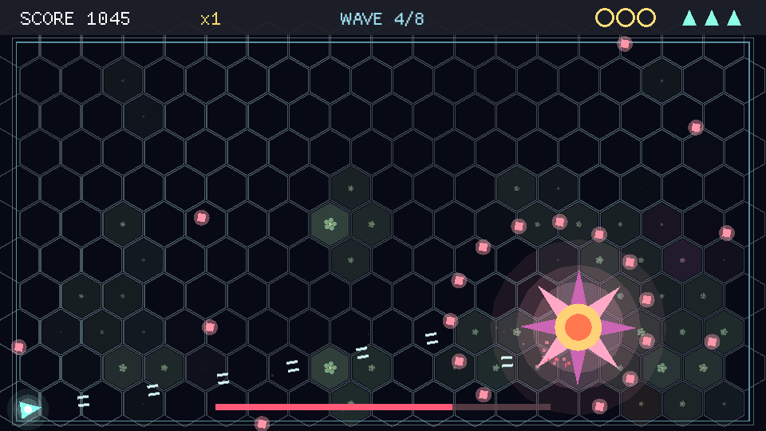
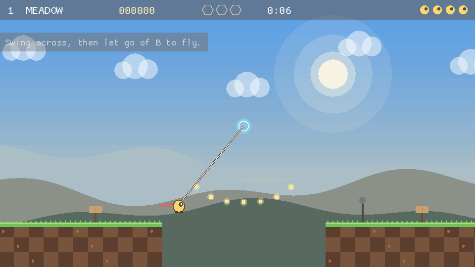
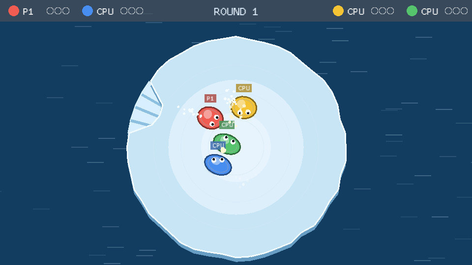
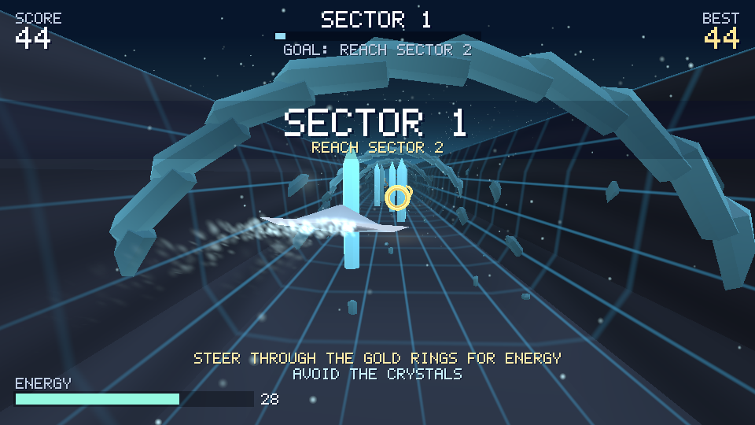
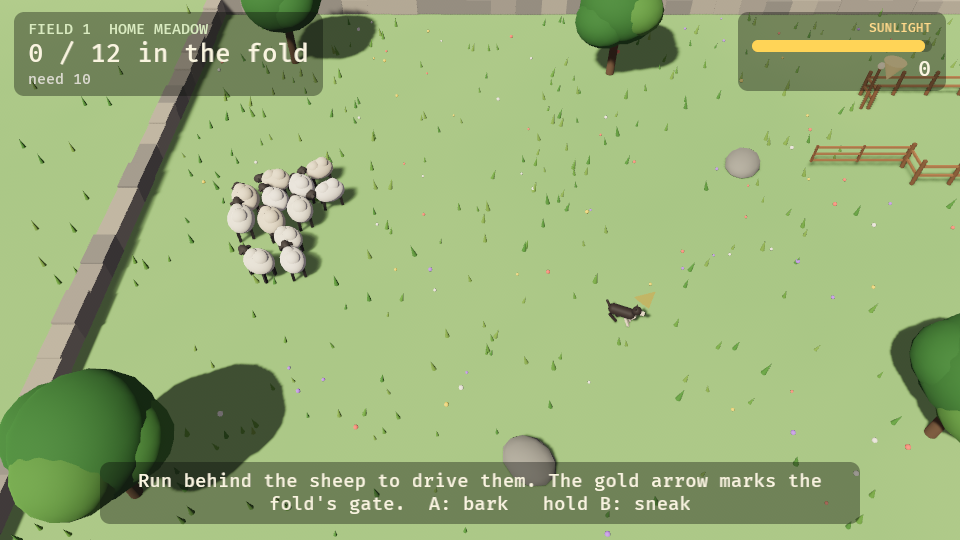
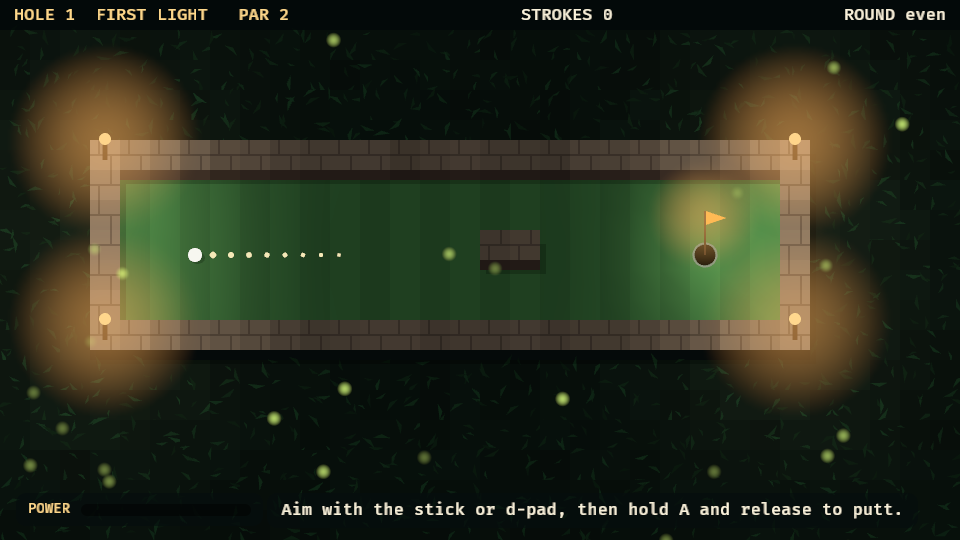
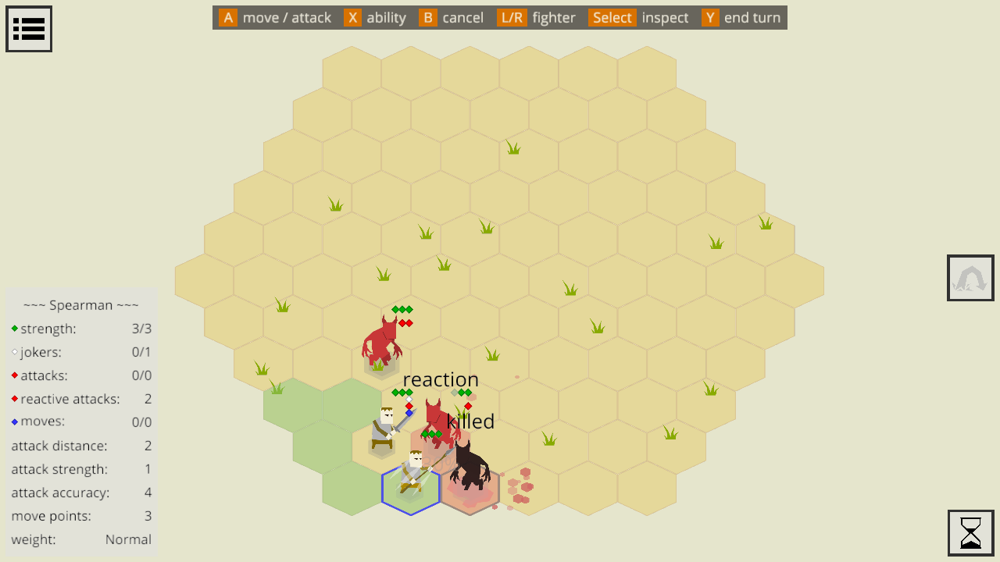

# wasmcart-rust-examples

<table>
<tr><td align="center"><a href="#hexbloom-macroquad"></a><br><b>Hexbloom</b></td><td align="center"><a href="#tetherline-macroquad"></a><br><b>Tetherline</b></td><td align="center"><a href="#bumper-floe-macroquad-1-to-4-players"></a><br><b>Bumper Floe</b></td></tr>
<tr><td align="center"><a href="#starwell-wgpu-3d"></a><br><b>Starwell</b></td><td align="center"><a href="#hillfold-bevy-3d"></a><br><b>Hillfold</b></td><td align="center"><a href="#lantern-links-bevy-2d"></a><br><b>Lantern Links</b></td></tr>
<tr><td align="center"><a href="#zemeroth-macroquad-port"></a><br><b>Zemeroth</b></td></tr>
</table>

Six original games and one port, written in Rust and built as
[wasmcart](https://github.com/wasmcart/wasmcart) carts. A `.wasc` holds a
WebAssembly program plus its assets and runs unmodified on every wasmcart
host: the browser, Node, the SDL player (`npx wasmcart`), RetroArch through
wasmcart-libretro, and Android.

Three are [macroquad](https://github.com/not-fl3/macroquad) games on
wasmcart's GL tier, through
[wasmcart-macroquad](https://github.com/wasmcart/wasmcart-macroquad), and
so is the port: Andrey Lesnikov's open-source tactics game
[Zemeroth](https://github.com/ozkriff/zemeroth), moved to macroquad 0.4. One is
a 3D game on raw [wgpu](https://wgpu.rs) through `wasmcart-wgpu` from
[wasmcart-rust](https://github.com/wasmcart/wasmcart-rust), on wasmcart's
WebGPU tier. Two are [Bevy](https://bevy.org) games through
[wasmcart-bevy](https://github.com/wasmcart/wasmcart-bevy), also on the
WebGPU tier.

Related: [wasmcart-rust](https://github.com/wasmcart/wasmcart-rust) (the
cart bindings, GL and `wasmcart-wgpu`),
[wasmcart-macroquad](https://github.com/wasmcart/wasmcart-macroquad) and
[wasmcart-bevy](https://github.com/wasmcart/wasmcart-bevy) (Bevy games as
carts).

## Quick start

**Just want to play?** Prebuilt carts are attached to the
[latest release](https://github.com/wasmcart/wasmcart-rust-examples/releases/latest).
With Node installed, play one straight from its URL:

```bash
npx wasmcart https://github.com/wasmcart/wasmcart-rust-examples/releases/latest/download/hexbloom.wasc
npx wasmcart https://github.com/wasmcart/wasmcart-rust-examples/releases/latest/download/tetherline.wasc
npx wasmcart https://github.com/wasmcart/wasmcart-rust-examples/releases/latest/download/floe.wasc
npx wasmcart https://github.com/wasmcart/wasmcart-rust-examples/releases/latest/download/starwell.wasc
npx wasmcart https://github.com/wasmcart/wasmcart-rust-examples/releases/latest/download/hillfold.wasc
npx wasmcart https://github.com/wasmcart/wasmcart-rust-examples/releases/latest/download/lantern-links.wasc
npx wasmcart https://github.com/wasmcart/wasmcart-rust-examples/releases/latest/download/zemeroth.wasc
```

A gamepad is the way to play every one of them. The keyboard works as a
fallback, and on a touch screen the host draws an on-screen pad with the
buttons each cart declares.

## The games

### Hexbloom (macroquad)


A twin-stick arena shooter in a glowing hex garden. Seeds swarm, darters
crouch and dash, splitters burst into sprouts and orbiters lob thorns. Every
enemy you clear makes its floor cell bloom in its colour, so the arena fills
with flowers as you play. Eight waves; waves 4 and 8 are guarded by a great
thorn flower that sprays rings of thorns with a gap to slip through. Pollen
from fallen enemies raises your score multiplier until you are hit.

| pad | does |
|---|---|
| left stick / d-pad | move |
| right stick | aim and fire |
| hold A | fire at the nearest enemy (plays with a d-pad alone) |
| B | bloom bomb: clears thorns and enemies around you (2 to 3 a wave) |
| Start | pause |

Keyboard: WASD move, arrows aim and fire, Space bomb, Enter start.
First goal: fell the first thorn flower at wave 4.

### Tetherline (macroquad)


A swinging platformer across five islands. Hold B and your tether catches
the ring marked ahead of you; push to swing higher, let go at the top of the
arc and fly. Reel the line in to climb over walls. Signs on the first island
teach each move once. Every island hides three sun shards; crumbling ledges,
spikes and rings that sway on the wind come later.

| pad | does |
|---|---|
| left stick / d-pad | run, aim the tether, swing |
| A | jump (and jump off a tether) |
| hold B | tether to the marked ring; let go to fly |
| up / down on a tether | reel in and out |
| Start | pause |

Keyboard: arrows, Z or Space jump, X tether, Enter start.
First goal: reach the flag of island 1. Five tries an island; out of tries,
you start that island again.

### Bumper Floe (macroquad, 1 to 4 players)


Round bumpers slide with real momentum on an ice floe that cracks and breaks
off at the edges, then melts to a small core so every round ends. Charge a
dash and shove the others into the sea; the last one on the ice wins the
round, first to three rounds wins the match. A puck on the ice makes your
next dash heavy. Each pad that presses A in the lobby takes its own seat;
empty seats are CPU bumpers (EASY, NORMAL or HARD), so one player can play a
whole match.

| pad | does |
|---|---|
| left stick / d-pad | slide |
| hold A, release | charge and dash |
| B | brake |
| lobby: A / B | join / leave your seat |
| lobby: left / right | CPU skill |
| Start | begin the match |

Keyboard (player 1): arrows, Space dash, X or Shift brake, Enter start.
First goal: win a match against EASY CPUs.

### Zemeroth (macroquad, port)


A turn-based tactics game on a hex map, by
[Andrey Lesnikov](https://github.com/ozkriff) and contributors:
[github.com/ozkriff/zemeroth](https://github.com/ozkriff/zemeroth). Lead a
small band of fighters through a campaign of short, brutal battles against
imps, their bombers and their summoners. Every fighter has a few moves,
attacks and jokers a turn; stepping next to an enemy invites its reactive
strike, so where you stand matters as much as whom you hit. Win a battle to
earn renown, then recruit or upgrade fighters before the next one.

This is a source port of upstream master at
[fae7d89](https://github.com/ozkriff/zemeroth/tree/fae7d89abe9702b25729453395e46fce105debbd),
vendored under `games/zemeroth` with its licence files; the port's changes
are separate commits on top, so `git log -- games/zemeroth` shows them. It
moves the game and its zgui and zscene crates from macroquad 0.3 to 0.4 on
wasmcart-macroquad, exports the sprites from the author's SVG atlas at a
size that fits a cart, and adds gamepad play on every screen: a focus that
the d-pad moves through the menus, a hex cursor in battle, and a bar of
button prompts along the top. The mouse and touch work as before. Rules,
balance and art are upstream's.

| pad | does |
|---|---|
| d-pad / left stick | move the focus, or the hex cursor in battle |
| A | choose; in battle: select, move, attack, use |
| B | back, cancel |
| X | cycle the selected fighter's abilities |
| Y | end the turn |
| L / R | previous / next fighter |
| Select | inspect the unit under the cursor |
| Start | menu |

Keyboard: arrows, Space (A), X or Esc (B), Z (X), C (Y), Q / E (L / R),
Tab (Select), Enter (Start). First goal: win the campaign's first battle.

### Starwell (wgpu, 3D)


Fly a glider down an endless crystal canyon. Gold rings give energy and
points, crystal pillars and beams cost energy, and the energy drains as you
fly. Each sector is faster and changes the canyon's colours. Lit, instanced
3D meshes (a few hundred on screen), up to eight point lights with fog, and
a compute shader driving 6144 particles (motes, the engine trail, ring
bursts) drawn as instances. It runs on WebGPU core devices and in
compatibility mode, the tier's floor (shaders encode sRGB themselves there).

| pad | does |
|---|---|
| left stick / d-pad | steer |
| A | start, confirm |
| Start | pause |

Keyboard: arrows or WASD, Space or Enter, Esc or P pause.
First goal: reach sector 2. The best score is kept in the cart's save data.

## Bevy games

Both are ordinary [Bevy](https://bevy.org) 0.20 apps (ECS, Bevy's renderer,
bevy_ui for the HUD) run as carts by
[wasmcart-bevy](https://github.com/wasmcart/wasmcart-bevy): `cart!` exports
the wasmcart entry points, the pads are Bevy `Gamepad`s, and Bevy draws
through the host's WebGPU device. They build for `wasm32-wasip1` and run on
core WebGPU devices and in compatibility mode, the tier's floor.

### Hillfold (Bevy, 3D)


Herd a flock of sheep into the fold before sundown. Each sheep steers
itself: it keeps to the flock, flees the dog, walks round walls and knows
the way home, so you drive the flock by where you stand. Run behind them to
push them on, bark to hurry a stubborn group, and sneak to slip round the
flock without scattering it. The sun sinks as the field's time runs out:
the light warms, the shadows stretch and the lantern at the gate comes on.
Once enough sheep are home, run into the fold to shut the gate, or fetch
the rest for a bonus. Five fields: an open meadow, stone walls with gaps, a
brook with two bridges, hedgerow lanes, and two flocks on a high pasture.
Bevy's PBR renderer with a shadow-casting sun and fog, up to 36 sheep that
are each a small hierarchy of entities, and the static scenery (stone
walls, hedges, fences, several hundred grass tufts and flowers) merged into
two vertex-coloured meshes so it costs two draws.

| pad | does |
|---|---|
| left stick / d-pad | run |
| A | bark (scares the sheep near you into a run) |
| hold B | sneak (slow, the sheep stay calm) |
| Start | pause |

Keyboard: arrows or WASD, Space or X bark, Z sneak, Enter pause.
First goal: pen 10 of the 12 sheep in Home Meadow. Missing a field's
target at sundown ends the run; A tries that field again.

### Lantern Links (Bevy, 2D)


Nine holes of minigolf in a night garden lit by lanterns: a straight
opener with a stone post, a dogleg, a ring of sand round the cup, a brook
with one crossing, slopes that pull the ball, bumpers, a turnstile to time
a putt past, a switchback and a last hole that has a bit of everything.
Aim dots show the line to the first wall; hold A to charge the putt and let
go. Water costs a stroke and puts the ball back; a hole is picked up at par
plus four. The round ends on a scorecard against par. The course is one
vertex-coloured mesh per hole with the lantern light baked in, and the
holes are a text file (`games/lantern-links/assets/holes.txt`) you can edit.

| pad | does |
|---|---|
| left stick | point the putt |
| d-pad left / right | turn the aim |
| hold B | aim finely (with the d-pad) |
| hold A, release | charge and putt (B while charging cancels) |
| Start | pause |

Keyboard: arrows turn the aim, Space or X putts, Z for fine aim, Enter
pause. First goal: sink hole 1.

## Building

You need [rustup](https://rustup.rs) and Node. `rust-toolchain.toml` picks
stable Rust (Bevy 0.20 needs 1.97 or newer) with the two targets the games
use: `wasm32-unknown-unknown` (macroquad, wgpu) and `wasm32-wasip1` (Bevy).

```bash
git clone https://github.com/wasmcart/wasmcart-rust-examples
cd wasmcart-rust-examples
npm install                 # wasmcart-pack and the hosts
scripts/build.sh            # dist/<game>.wasc for every game
scripts/build.sh hexbloom   # or just one
npx wasmcart dist/hexbloom.wasc
```

`scripts/build.sh` builds each game in `games/` with cargo and packs it with
`wasmcart-pack` (`scripts/pack.mjs`): the version is the crate's, the title,
description, controls and player count come from the game's `cart.json`,
the WAV assets from its `assets/`, and the launcher art from its `art/`.
A game's `cart.json` may also name its cargo target (`"target": "wasm32-wasip1"`
for the Bevy games) and its size.

## Your own game

Copy a game directory and rename the package:

```bash
cp -r games/hexbloom games/mygame     # a macroquad game
cp -r games/starwell games/mygame     # a wgpu game
cp -r games/lantern-links games/mygame  # a Bevy game
# edit games/mygame/Cargo.toml (name), cart.json, src/
scripts/build.sh mygame && npx wasmcart dist/mygame.wasc
```

A **macroquad** game is an ordinary macroquad binary crate. The workspace
`Cargo.toml` points miniquad at wasmcart-macroquad's patched copy, and the
game depends on the backend for pads, rumble and debug values:

```toml
[dependencies]
macroquad = { version = "0.4", features = ["audio"] }
wasmcart-macroquad = { git = "https://github.com/wasmcart/wasmcart-macroquad", rev = "eb7b0f5", features = ["debug"] }

# in the workspace root
[patch.crates-io]
miniquad = { git = "https://github.com/wasmcart/wasmcart-macroquad", rev = "eb7b0f5" }
```

Read every connected pad with `wasmcart_macroquad::pad(i)` and OR them, so a
player on any pad can play and an idle second pad changes nothing; call
`set_pad_keymap(&[])` when you read pads directly (a multiplayer game must,
or every pad also presses the keyboard's keys).

A **wgpu** game is a `cdylib` with `wasmcart` and `wasmcart-wgpu`; see
[wasmcart-rust's README](https://github.com/wasmcart/wasmcart-rust#webgpu-carts-with-wgpu).
Starwell mixes its own audio into the cart's audio ring (`src/sound.rs`).

A **Bevy** game is a `cdylib` built for `wasm32-wasip1` with
`wasmcart-bevy` and Bevy (`default-features = false`); the workspace
`Cargo.toml` patches three Bevy crates to wasmcart-bevy's copies, as its
[README](https://github.com/wasmcart/wasmcart-bevy#cargo-setup) explains:

```toml
[dependencies]
wasmcart-bevy = { git = "https://github.com/wasmcart/wasmcart-bevy", rev = "52cc476", features = ["render"] }
bevy = { version = "0.20.1", default-features = false, features = ["std", "bevy_render", ...] }

# in the workspace root
[patch.crates-io]
bevy_asset = { git = "https://github.com/wasmcart/wasmcart-bevy", rev = "52cc476" }
bevy_render = { git = "https://github.com/wasmcart/wasmcart-bevy", rev = "52cc476" }
bevy_log = { git = "https://github.com/wasmcart/wasmcart-bevy", rev = "52cc476" }
```

Read every `Gamepad` and merge them (both Bevy games build one `Ctl`
resource a frame from all pads), so any pad plays and an idle one changes
nothing. Their autopilots read the `autopilot` debug field with
`CartDebug::get`.

Sounds and music are generated by each game's `gen-assets.mjs` with the small
synthesizer in `scripts/lib/synth.mjs`; the WAVs are committed. Launcher art
is made by `scripts/make-art.mjs` from the screenshots the checks save.

## Checks

```bash
scripts/test.sh
```

Builds every game, then runs each game's `check.mjs` on the wasmcart Node
host (real GL, and real WebGPU on a core device and in compatibility mode).
The WebGPU games (Starwell and both Bevy games) run every check twice, once
on each device level; the Bevy games also assert which one Bevy got
(their `gpu.core` debug field).
The checks drive real pads: A starts, the stick moves, the right stick
fires, holding B tethers, B sneaks, A barks and putts, a second pad joins its own seat, an idle pad in
seat 2 changes nothing. Zemeroth's checks walk its menus and campaign on
the d-pad, use mouse and touch, and win the first campaign battle with pad
presses: its autopilot, set to 2, only names each press (debug field
`ap_bits`) and the check makes it on a real pad; `seed` fixes the dice. They assert on pixels, motion between frames, named
debug values and the audio ring.

Each game also has a test autopilot that plays it the way its screens teach,
switched on by a debug host writing the debug field `autopilot` (Starwell:
`autoplay`) to 1. Hillfold also takes `start_field` and Lantern Links
`start_hole` (written before pressing A on the title), and Lantern Links'
`auto_noise` (0 to 2) makes its autopilot miss its aim and power the way a
person does, to judge how hard the holes are. Carts built without debug values have no such switch. The
checks use it to reach each first goal, and the same switch lets
romdev play a cart for thousands of
frames in one call:

```js
loadMedia({ platform: 'wasmcart', path: 'dist/tetherline.wasc' })
frame({ op: 'step', frames: 40 })
wasm({ op: 'write', name: 'autopilot', value: 1 })
frame({ op: 'step', frames: 6000, stopWhen: { field: 'level', equals: 1 } })
```

Every check has a control that must fail (a black frame, a frame compared
with itself, a run with no input, a run with the autopilot off, the silent
first frames). A control that passes means the check cannot tell a working
cart from a broken one, and fails the gate.

Every game was also run through romdev's photosensitivity check
(`frame({op:'flash'})`) over its title, play, hits and game over: nothing
flashes, flashes swell and fade, and there is no screen shake (big hits
rumble the pad instead).

## Credits and license

MIT, see [LICENSE](LICENSE), except `games/zemeroth`: Zemeroth is MIT or
Apache-2.0 (its `LICENSE-MIT` and `LICENSE-APACHE`), as are the port's
changes to it. Every sound, picture and font use is listed in
[CREDITS.md](CREDITS.md): all of it is generated from code in this
repository, except Zemeroth's own art and font.
